# RevoShop — Next.js Frontend (Module 3)

The RevoShop storefront, built with **Next.js (App Router)**, **React**,
**TypeScript**, and **Tailwind CSS**. It renders live data from the Module 2
Flask API and adds authentication, a persistent cart, checkout, customer
orders, and a full admin dashboard (product and category CRUD + order
overview), with toast notifications throughout.

- **Live API (Module 2):** https://revoushop-afo.onrender.com
  (Flask on Render + PostgreSQL on Supabase)

## Overview

RevoShop is a role-aware e-commerce frontend:

- **Logged-out visitors** can browse the home page, the product list, product
  details, and categories.
- **Customers** (role `Customer`) can register, log in, add products to a cart
  that persists across refreshes, check out to place an order, and view their
  own orders.
- **Admins** (role `Admin`) get a dashboard with full product CRUD (with a
  deletion guard for products in active orders), full category CRUD (with a
  deletion guard for categories that still have linked products), and a
  read-only overview of every user's orders.

## Features implemented

### Pages / routes

| Route | Access | What it does |
| --- | --- | --- |
| `/` | public | Landing page with real products |
| `/products` | public | Product grid; live search + category filter via URL; add to cart |
| `/products/[id]` | public | Product detail with dynamic `<title>` and an Add to Cart button |
| `/categories` | public | Category list, each linking to its filtered products |
| `/register` | public (redirects if signed in) | Registration form; on success auto-logs-in and redirects by role |
| `/login` | public (redirects if signed in) | Login form; redirects to `/dashboard` (admin) or `/` (customer); inline error on bad credentials |
| `/cart` | customer | Cart table (qty, subtotal), per-row remove, empty state, checkout disabled when empty; persists via localStorage |
| `/checkout` | customer | Shipping form + order summary; confirms the order, clears the cart, redirects to `/orders` |
| `/orders` | customer | The signed-in user's own orders |
| `/orders/[id]` | customer | Order detail with a line-item table |
| `/dashboard` | admin | Product CRUD (create / edit inline / delete) |
| `/dashboard/categories` | admin | Category CRUD + frontend deletion guard |
| `/dashboard/orders` | admin | Read-only order overview across all users |

### Major functionality

- **Authentication** — email/password login and registration against the Flask
  API. The session (JWT + user, including role) is stored in `localStorage`, so
  the header keeps showing the username across refreshes. Registration
  auto-logs-in.
- **Role-based redirects & route guards** — a `ProtectedRoute` component
  redirects logged-out users to `/login` and non-admins away from
  `/dashboard/*`. Login/register redirect by role.
- **Persistent cart** — a global `CartContext` backed by `localStorage`.
  `AddToCartButton` and the catalog grid add items; the cart survives refreshes.
- **Checkout** — posts the cart as an order (`POST /orders`), clears the cart,
  and redirects to the orders list.
- **Admin product CRUD** — `CreateProductForm`, inline `EditProductForm`, and a
  product table with delete. Deleting a product that has active orders shows the
  backend's guard error (HTTP 409).
- **Admin category CRUD** — create / edit / delete, with a **frontend deletion
  guard**: a category with linked products cannot be deleted (the backend
  soft-deletes without a server-side guard, so the check is enforced in the UI).
- **Toast notifications** — `react-hot-toast` shows success/error toasts for
  cart actions, checkout, product/category CRUD, and auth.

## Technologies used

- **Next.js (App Router)** + **React** + **TypeScript**
- **Tailwind CSS** for styling
- **react-hot-toast** for toast notifications
- **next/navigation** (`useRouter`, `usePathname`) for client navigation and
  active links
- **localStorage** for session + cart persistence
- **Playwright** for end-to-end tests
- **`NEXT_PUBLIC_API_BASE_URL`** to point the app at the Flask API

## Project structure

```
revoshop/
├── e2e/                         # Playwright E2E tests
│   ├── auth.spec.ts             # register / login / logout / validation
│   ├── shopping.spec.ts         # products -> cart -> checkout -> orders
│   ├── admin.spec.ts            # admin product + category CRUD
│   └── helpers.ts               # shared test helpers
├── src/
│   ├── app/
│   │   ├── layout.tsx           # root layout + Providers (Header/Footer)
│   │   ├── providers.tsx        # Auth + Cart providers + <Toaster>
│   │   ├── page.tsx             # home
│   │   ├── login/ register/     # auth pages
│   │   ├── products/            # list + [id] detail (+ loading/error)
│   │   ├── categories/          # category list
│   │   ├── cart/ checkout/      # cart + checkout
│   │   ├── orders/              # orders list + [id] detail
│   │   └── dashboard/           # layout guard + products / categories / orders
│   ├── components/              # forms, tables, nav, cart, guards, toasts
│   ├── context/
│   │   ├── AuthContext.tsx      # session state (localStorage)
│   │   └── CartContext.tsx      # cart state (localStorage)
│   └── lib/
│       ├── api.ts               # centralized API client (typed results)
│       ├── auth.ts              # role -> destination helper
│       └── orders.ts            # order status/date helpers
├── playwright.config.ts
├── .env.example
└── next.config.ts
```

## How to run the project locally

Prerequisites: Node.js 20+ and the Module 2 Flask API reachable (the hosted URL
works, or run it locally).

```bash
# from this folder (revoshop/)
npm install
cp .env.example .env.local      # then set NEXT_PUBLIC_API_BASE_URL
npm run dev                     # http://localhost:3000
```

Production build:

```bash
npm run build && npm run start
```

### Environment variables

Configured in `.env.local` (git-ignored). See `.env.example` for all keys.

| Key | Purpose |
| --- | --- |
| `NEXT_PUBLIC_API_BASE_URL` | Base URL of the Flask API (readable in the browser). |
| `API_SECRET_KEY` | Optional server-only secret (unused by default). |
| `E2E_ADMIN_EMAIL` / `E2E_ADMIN_PASSWORD` | Admin credentials for the Playwright admin tests (optional; only needed to run `admin.spec.ts`). |

## How to run the test suite (Playwright)

The E2E tests drive the real app against the live API. They start the dev
server automatically.

```bash
# install the browser once
npx playwright install chromium

# run the whole suite (headless)
npm run test:e2e

# interactive UI mode
npm run test:e2e:ui

# a single spec
npx playwright test e2e/auth.spec.ts
```

To run the **admin** tests (`admin.spec.ts`), set admin credentials in
`.env.local`:

```
E2E_ADMIN_EMAIL=your-admin@example.com
E2E_ADMIN_PASSWORD=your-admin-password
```

> Note: the hosted backend runs on free tiers and may cold-start (first request
> can take ~50s). The Playwright timeouts are set generously to accommodate this.

### What the tests cover

- **`auth.spec.ts`** — registration/login flow: register → auto-login → logout
  → login again; invalid-credentials error; required-field validation.
- **`shopping.spec.ts`** — full browsing journey: products list → add to cart →
  checkout → orders; plus the empty-cart disabled checkout.
- **`admin.spec.ts`** — full admin CRUD journey: create → edit → delete a
  product (self-cleaning), and create a category.

## Verification status

Verified end-to-end against the live API:

- `npm run build` — passes (Next.js 16.4.0, TypeScript check clean, all routes
  generated).
- `npm run test:e2e` — the full Playwright suite passes (`auth`, `shopping`, and
  `admin` specs) against `https://revoushop-afo.onrender.com`.
- All major-page screenshots below were captured from the running app.

> An earlier Supabase platform incident briefly made the hosted database return
> HTTP 500 on data-backed endpoints; it has since recovered, and live
> verification (build, E2E, screenshots) was completed afterward.

## Screenshots

Captured against the live API, covering every major page.

### Home
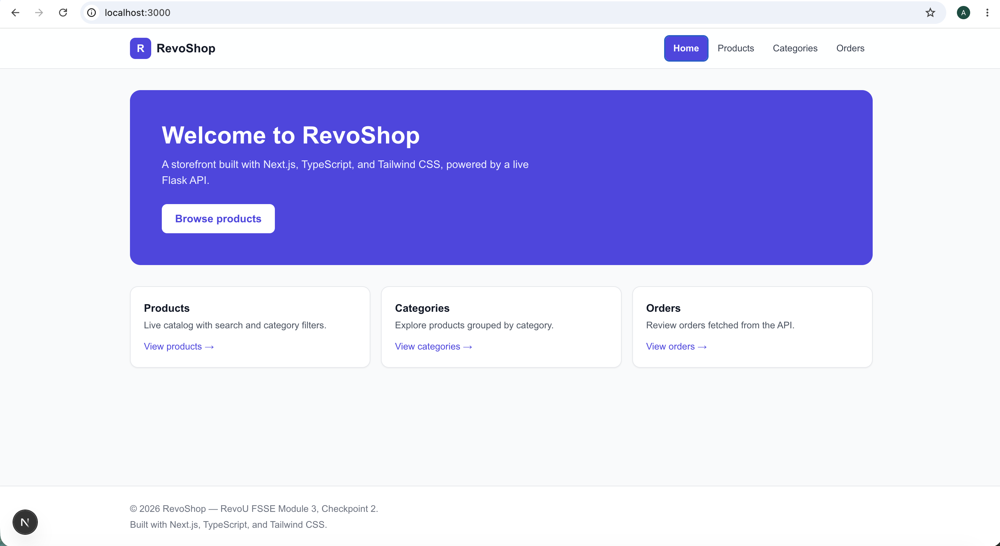

### Products — grid of real products
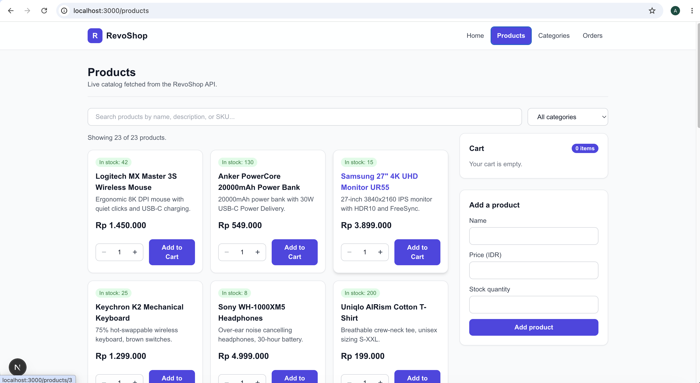

### Products — live search
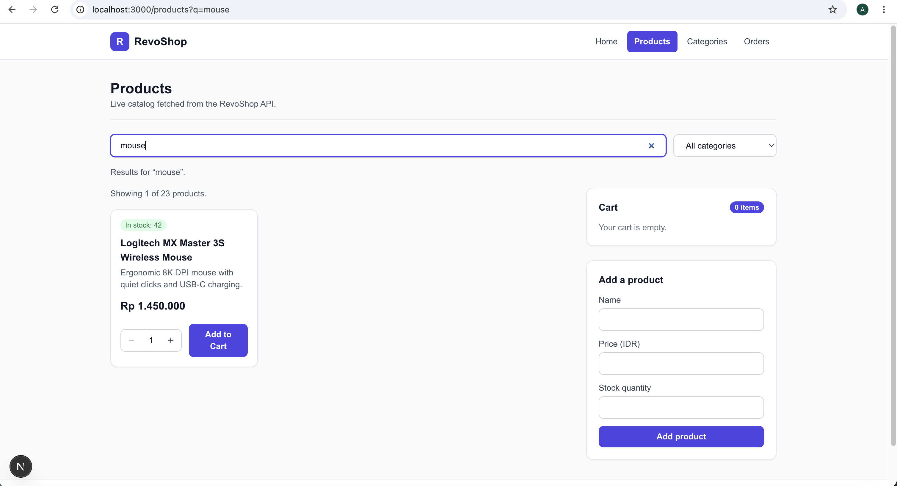

### Products — category filter
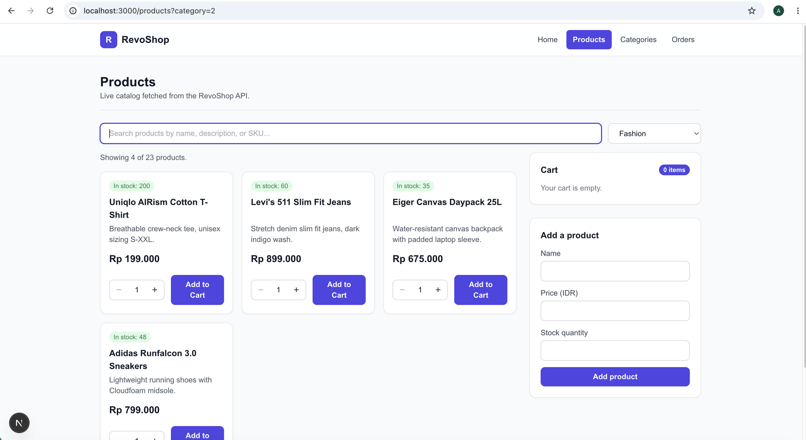

### Product detail
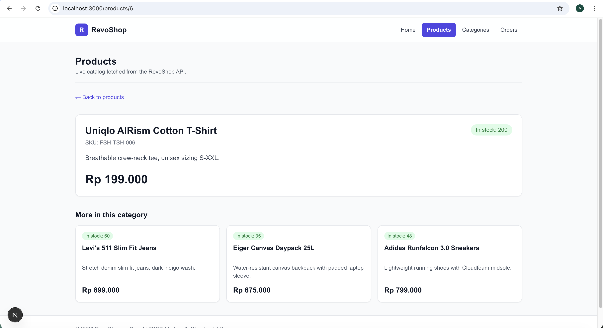

### Active-route highlight in the nav
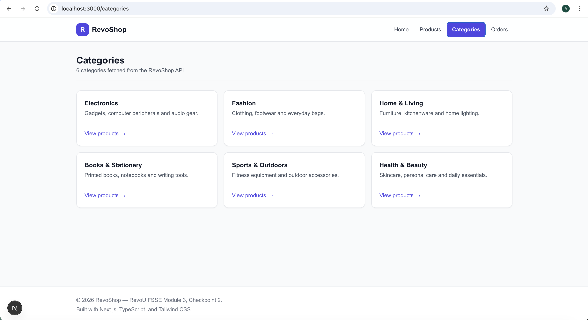

### Cart
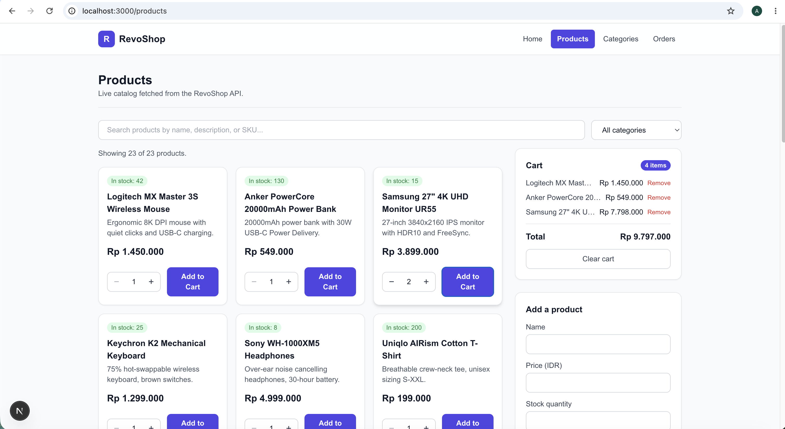

### Add product (admin dashboard form)
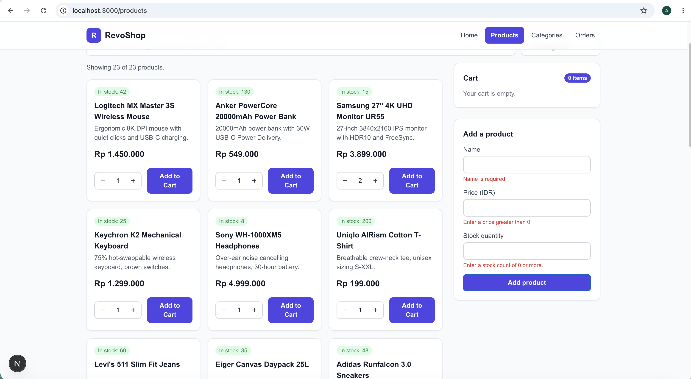

### Register
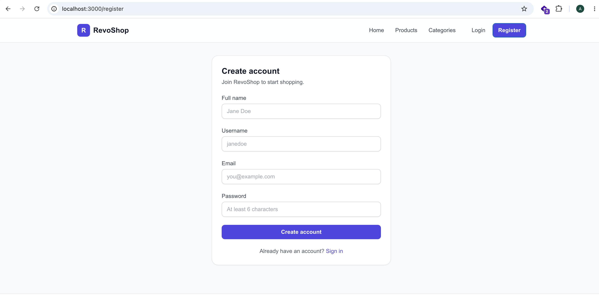

### Login
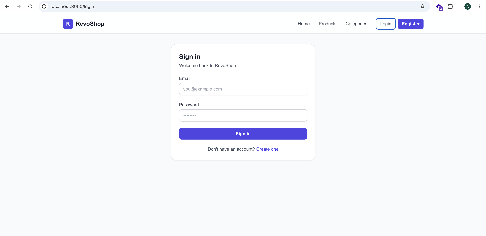

### Category listing
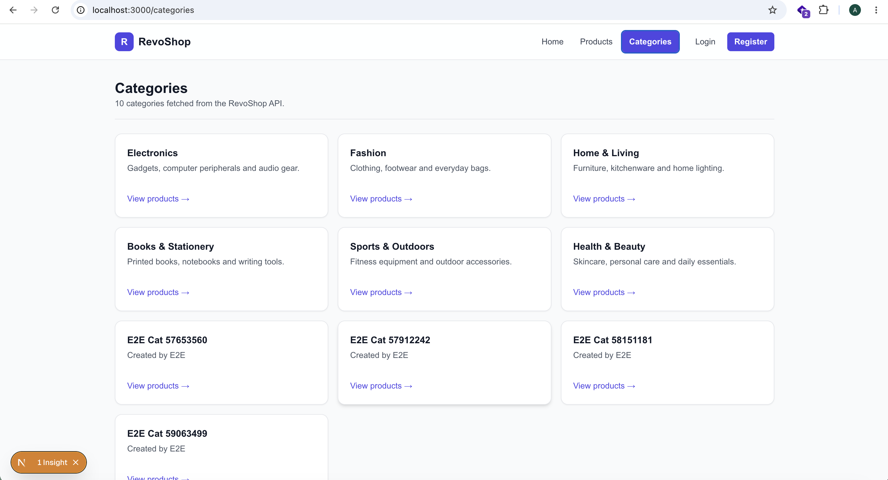

### Admin dashboard
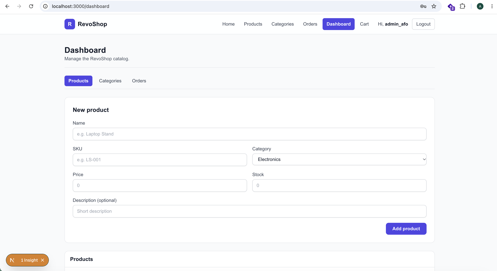

## Notes on backend behavior (Module 2)

- **Orders are role-scoped.** `GET /orders` returns the signed-in user's own
  orders for customers, and **all** users' orders for admins (a Module 2 change
  was made so the admin order overview works).
- **Category deletion is a soft delete** with no server-side guard, so the
  "can't delete a category with linked products" rule is enforced on the
  frontend.
- **Product deletion is guarded** server-side: deleting a product that is part
  of an active order returns HTTP 409, which the dashboard surfaces as a visible
  error/toast.

## Tech

Next.js (App Router) · React · TypeScript · Tailwind CSS · react-hot-toast ·
Playwright
