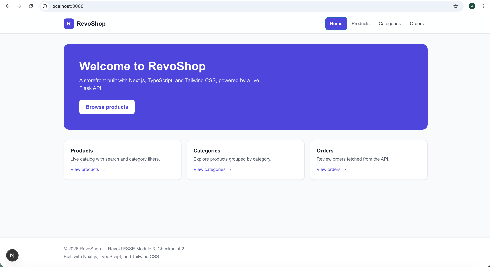
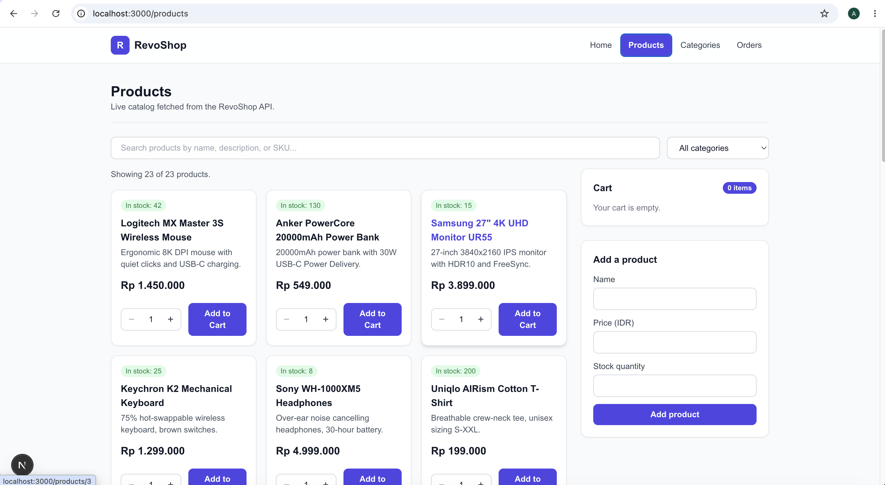
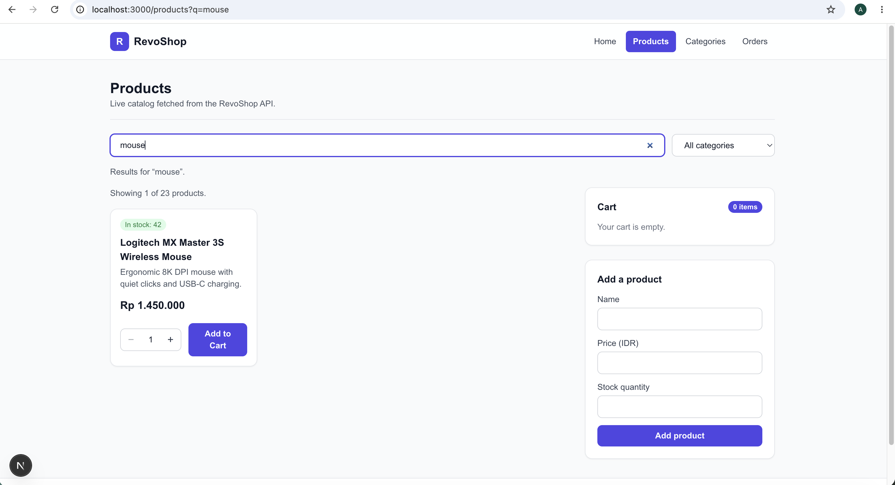
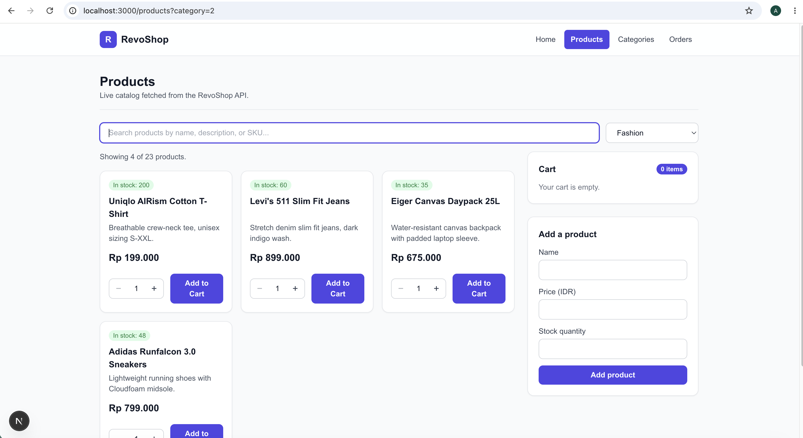
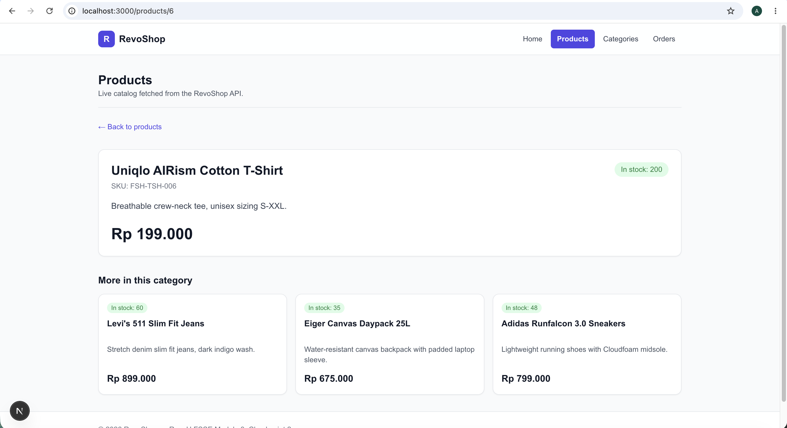
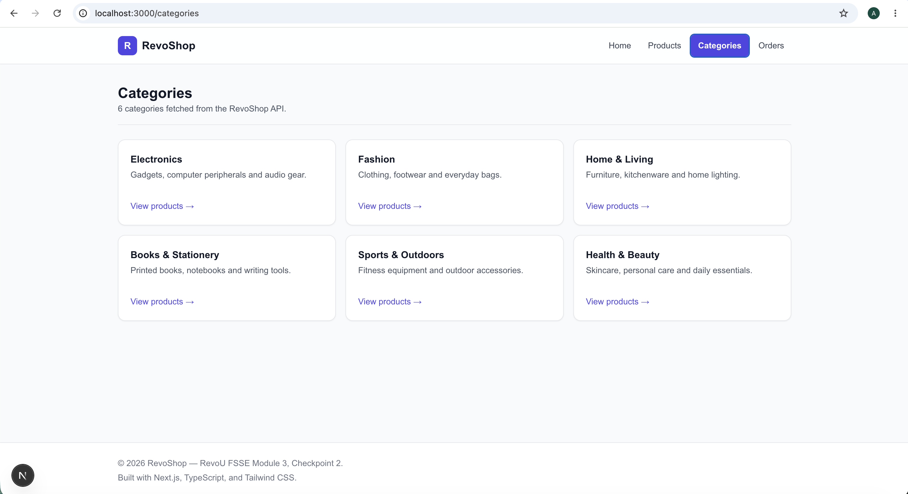
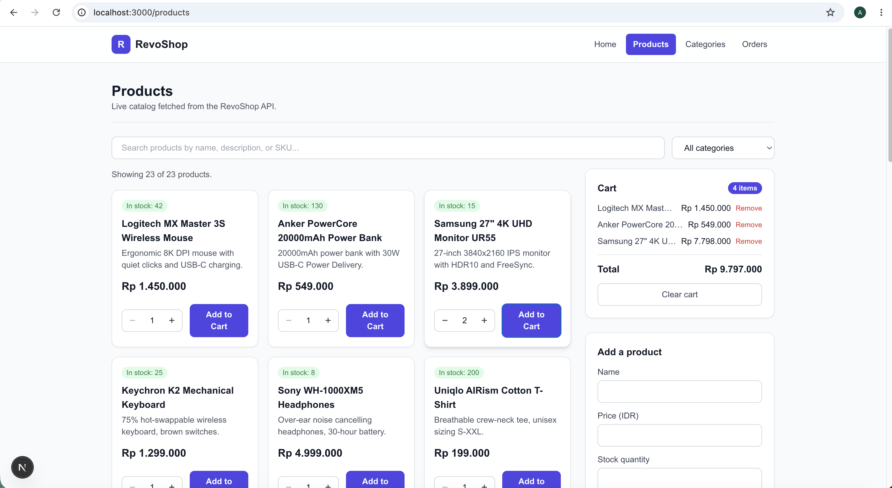
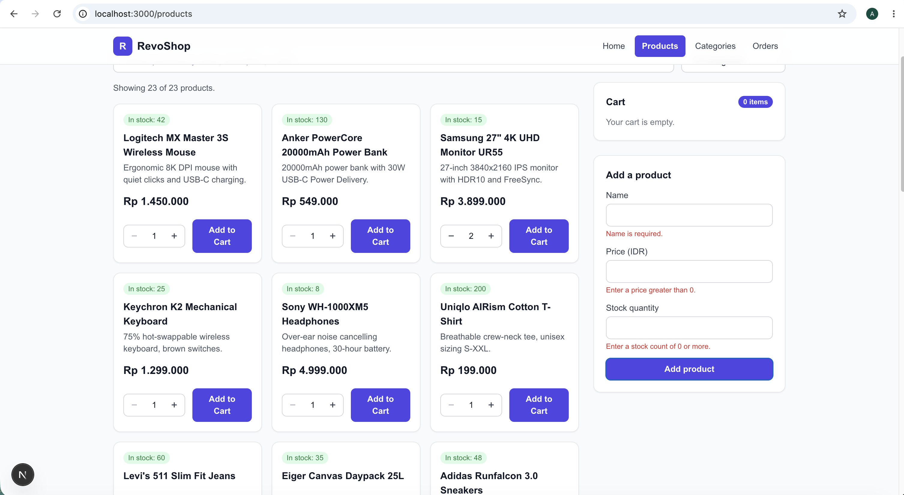

# RevoShop — Next.js Frontend (Module 3, Checkpoint 2)

The RevoShop storefront built with **Next.js (App Router)**, **TypeScript**, and
**Tailwind CSS v3**. It renders live data from the Module 2 Flask API using
Server Components, with file-based routing, reusable typed components, live
search, a client-side cart, and loading/error states on every data route.

- **Live API (Module 2):** https://revoushop-afo.onrender.com
  (Flask on Render + PostgreSQL on Supabase)

## Getting started

```bash
# from this folder (revoshop/)
npm install
cp .env.example .env.local   # then set NEXT_PUBLIC_API_BASE_URL
npm run dev                  # http://localhost:3000
```

Production build:

```bash
npm run build && npm run start
```

### Environment variables

Configured in `.env.local` (git-ignored). See `.env.example` for the keys.

| Key | Purpose |
| --- | --- |
| `NEXT_PUBLIC_API_BASE_URL` | Base URL of the Flask API. `NEXT_PUBLIC_` makes it readable in the browser. |
| `API_SECRET_KEY` | Server-only token for the auth-protected orders endpoint (optional). |

## Project structure

```
revoshop/
├── src/
│   ├── app/
│   │   ├── layout.tsx            # root layout: Header + Footer on every page
│   │   ├── page.tsx              # home landing
│   │   ├── products/
│   │   │   ├── layout.tsx        # nested layout (stays mounted list <-> detail)
│   │   │   ├── page.tsx          # products list (Server Component fetch)
│   │   │   ├── loading.tsx       # skeleton
│   │   │   ├── error.tsx         # friendly error UI
│   │   │   └── [id]/             # product detail + generateMetadata (dynamic title)
│   │   ├── categories/           # categories list + loading + error
│   │   └── orders/               # orders (auth-protected) + loading + error
│   ├── components/
│   │   ├── Card.tsx              # reusable surface wrapper
│   │   ├── Header.tsx / Nav.tsx  # header + active-route nav (usePathname)
│   │   ├── Footer.tsx
│   │   ├── ProductCard.tsx       # typed card: counter + stock states
│   │   ├── SearchControls.tsx    # search + category filter (URL query)
│   │   ├── ProductCatalog.tsx    # client orchestrator: grid + cart + form
│   │   ├── CartSummary.tsx       # item count + Rupiah total (reduce)
│   │   └── AddProductForm.tsx    # validated form, appends a product
│   ├── lib/api.ts                # centralized API client + formatRupiah
│   └── types/index.ts            # Product, Category, Order, union types
├── .env.example                 # placeholder env keys (tracked)
├── tailwind.config.js           # Tailwind v3 config
└── next.config.ts
```

## Routes

| Route | Data | Notes |
| --- | --- | --- |
| `/` | — | Landing page |
| `/products` | `GET /products` | Server fetch, live search + category filter via URL, cart + add-product |
| `/products/[id]` | `GET /products/:id` | Dynamic `<title>` via `generateMetadata`; related products |
| `/categories` | `GET /categories` | Real categories, each links to filtered products |
| `/orders` | `GET /orders` | Auth-protected (see note below) |

## Key behaviors

- **Server Component data fetching** — products, product detail, categories,
  and orders are fetched on the server in `lib/api.ts`.
- **loading.tsx / error.tsx** — every data route shows a skeleton while
  fetching and a friendly error UI on failure.
- **Active-route nav** — `usePathname()` highlights the current section.
- **Search by URL** — the search box and category dropdown write `?q=` and
  `?category=` with `router.push()`; the server reads them and returns the
  filtered list, so the URL is shareable.
- **Dynamic metadata** — the product detail page sets a per-product browser
  tab title.
- **Cart (client state)** — "Add to Cart" updates cart state immutably; the
  summary shows item count and total (Rupiah) via `reduce`.
- **Add product** — a validated form appends a new typed product to the list.

## Screenshots

Running locally against the live API.

### Home


### Products — grid of real products from the API


### Products — live search (updates the URL query)


### Products — category filter


### Product detail — dynamic page title


### Active-route highlight in the nav


### Cart — Add to Cart with item count and Rupiah total


### Add product — validated form appends to the list


## Note on the Orders route

The Module 2 API protects `GET /orders` with JWT auth, so without a valid
token it returns `401`. The database seed ships placeholder password hashes and
`/auth/login` does not accept them, so no valid credentials are available for a
public demo. The `/orders` route handles this honestly: it fetches on the
server and, when unauthorized, shows a clear "sign in to view orders" notice
instead of crashing. The code already renders real orders when a token is set
via `API_SECRET_KEY` — the status badges and totals are wired to the typed
`Order` shape.

## Tech

Next.js (App Router) · React · TypeScript · Tailwind CSS v3
